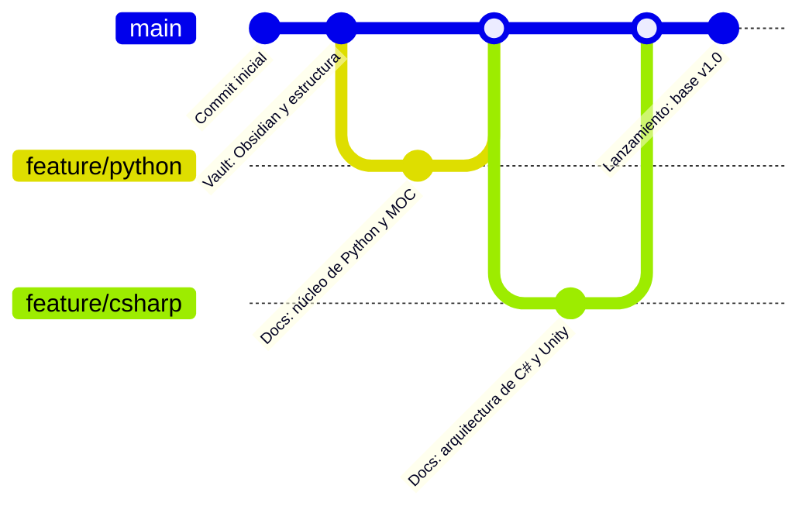

<div align="center">

# 🧠 Base de Conocimiento para Desarrolladores


<p>Un repositorio técnico estructurado y multilenguaje sobre fundamentos de ciencias de la computación, patrones de arquitectura de software y flujos de trabajo de ingeniería — con cada ejercicio planteado alrededor de la creación de videojuegos.</p>

</div>

**English:** [README.md](README.md)


> **Nota**
> Esta base de conocimiento funciona como un repositorio central de documentación, arquitecturas de referencia y notas de código escritas en **Obsidian** y renderizadas directamente en **GitHub**. Las notas en español son traducciones de las originales en inglés y se mantienen como un espejo: el inglés es la versión de referencia.

## 🗺️ Dominios de Conocimiento y MOCs

Cada dominio es autónomo y abre con un **MOC** (Mapa de Contenidos): una nota índice que
enumera cada tema con una descripción de una línea, para entrar por el mapa en lugar de
recorrer una carpeta.

| Dominio | Descripción | Notas | Estado | Mapa de Contenidos |
| :--- | :--- | :--- | :--- | :--- |
| 🐍 **Python** | Sintaxis básica, control de flujo, estructuras de datos, POO y ecosistemas | 11 EN · 11 ES | 🟢 Activo | [EN](%F0%9F%90%8D%20Python/README.md) · [ES](%F0%9F%90%8D%20Python/README-ES.md) |
| 🚀 **Git & GitHub** | Control de versiones, estrategias de ramificación, colaboración y flujos de PR | 4 EN · 4 ES | 🟢 Activo | [EN](%F0%9F%9A%80%20Git%20&%20GitHub/README.md) · [ES](%F0%9F%9A%80%20Git%20&%20GitHub/README-ES.md) |
| 🟣 **CSharp** | Herramientas de Emberforge: tipos estáticos, control de flujo, matrices, métodos y un proyecto de consola | 8 EN · 8 ES | 🟢 Activo | [EN](%F0%9F%9F%A3%20CSharp/README.md) · [ES](%F0%9F%9F%A3%20CSharp/README-ES.md) |
| 🧮 **Estructuras de Datos y Algoritmos** | Estructuras de datos fundamentales, eficiencia de algoritmos y resolución de problemas | 5 EN · 5 ES | 🟢 Activo | [EN](%F0%9F%A7%AE%20Data%20Structures%20&%20Algorithms/README.md) · [ES](%F0%9F%A7%AE%20Data%20Structures%20&%20Algorithms/README-ES.md) |
| 🖥️ **Línea de Comandos** | Navegación en la terminal, gestión de archivos, permisos y flujo de trabajo en la shell | 13 EN · 13 ES | 🟢 Activo | [EN](%F0%9F%96%A5%EF%B8%8F%20Command%20Line/README.md) · [ES](%F0%9F%96%A5%EF%B8%8F%20Command%20Line/README-ES.md) |
| 🤖 **GenAI** | Cómo funcionan los LLM, ingeniería de prompts, embeddings y modos de fallo de la IA | 6 EN · 6 ES | 🟢 Activo | [EN](%F0%9F%A4%96%20GenAI/README.md) · [ES](%F0%9F%A4%96%20GenAI/README-ES.md) |
| 🌐 **HTML** | Estructura de páginas web, elementos, atributos, estilos y formularios | 6 EN · 6 ES | 🟢 Activo | [EN](%F0%9F%8C%90%20HTML/README.md) · [ES](%F0%9F%8C%90%20HTML/README-ES.md) |
| 🎨 **CSS** | Estilos, selectores, colores, el modelo de caja, posicionamiento y maquetación flexbox | 14 EN · 14 ES | 🟢 Activo | [EN](%F0%9F%8E%A8%20CSS/README.md) · [ES](%F0%9F%8E%A8%20CSS/README-ES.md) |
| 🟨 **JavaScript** | Variables, control de flujo, arreglos, funciones, objetos, el DOM y eventos | 10 EN · 10 ES | 🟢 Activo | [EN](%F0%9F%9F%A8%20JavaScript/README.md) · [ES](%F0%9F%9F%A8%20JavaScript/README-ES.md) |
| ⚛️ **React** | Componentes, JSX, props y estado, hooks, contexto, obtención de datos y enrutamiento | 17 EN · 17 ES | 🟢 Activo | [EN](%E2%9A%9B%EF%B8%8F%20React/README.md) · [ES](%E2%9A%9B%EF%B8%8F%20React/README-ES.md) |
| ⚙️ **C++** | Fundamentos de motor: tipos, control de flujo, colecciones, clases, memoria | 53 EN · 53 ES | 🟢 Activo | [EN](%E2%9A%99%EF%B8%8F%20C%2B%2B/README.md) · [ES](%E2%9A%99%EF%B8%8F%20C%2B%2B/README-ES.md) |
| 🏗️ **Ingeniería de Software** | Patrones de diseño, algoritmos y arquitectura de sistemas | — | 🟡 Planificado | *Próximamente* |
| 🎮 **Arquitectura de Juegos** | Mecánicas interactivas, patrones de motor y física | — | 🟡 Planificado | *Próximamente* |

**Numeración de los temas.** Las notas llevan un prefijo para que el dominio se lea en orden
de aprendizaje — `01`, `02`, `03`… Las chuletas usan el prefijo `00b` / `00c` y se sitúan
*antes* de la secuencia numerada, porque están pensadas para consultarse mientras se trabaja
y no para leerse de principio a fin.

**Los módulos que se apoyan en otros.** 🤖 **GenAI** es la capa de IA de esta vault: parte
del Python de 🐍 **Python** y construye un predictor del siguiente token, una biblioteca de
prompts y un motor de búsqueda semántica en Python puro, de modo que las herramientas de IA
se entiendan por dentro en lugar de pedirlas prestadas a una API. ⚛️ **React** es su
equivalente web: parte de los módulos de 🟨 **JavaScript**, 🌐 **HTML** y 🎨 **CSS** y
convierte sus páginas estáticas en una aplicación de página única viva. ⚙️ **C++** es la
contraparte de bajo nivel de esa pila: la misma lógica, los mismos bucles y objetos, pero con
la memoria y los tipos en tus manos — el paso entre escribir un juego y entender la máquina
sobre la que corre.

**Cómo leer una nota.** Cada una es una lección autónoma: un concepto, un ejemplo ejecutable,
su salida por consola y las trampas que conviene conocer. Los bloques de código se ejecutan
tal cual — los comentarios indican la salida que deberías obtener realmente.

**El espejo en español.** Todos los temas existen en ambos idiomas. El inglés es la versión de
referencia; la nota en español incluye una línea `**Versión original en inglés:**` al principio
que enlaza a su original. Dentro de los bloques en español, las variables y las cadenas están
traducidas, mientras que las palabras clave del lenguaje, los nombres de API y los nombres de
clase permanecen en inglés.

## 🌍 Idiomas

| Versión | Ruta de entrada | Estado |
| :--- | :--- | :--- |
| 🇬🇧 Inglés (original) | [README.md](README.md) | 🟢 Base de referencia |
| 🇪🇸 Español (traducción) | [README-ES.md](README-ES.md) | 🟢 Sincronizado |

Cada nota existe en ambos idiomas. Las notas en español incluyen una línea
`**Versión original en inglés:**` en la parte superior que enlaza a su nota original. El inglés
es la versión de referencia y el español se mantiene como su espejo.

## 🛠️ Arquitectura del Repositorio

Las notas se guardan como **pares de nombres de archivo** en la misma línea: primero la nota
en inglés y, tras el separador `·`, su traducción al español.

```text
Developer-Knowledge-Base/
├── README.md                              <-- Portada en inglés (referencia)
├── README-ES.md                           <-- Portada en español (espejo)
├── LICENSE
├── .gitignore
│
├── tools/                                 <-- verificadores de la vault (ver abajo)
├── .github/workflows/                      <-- los ejecuta en cada push
│
├── 🐍 Python/                             <-- 11 temas · EN + ES
│   ├── README.md          ·  README-ES.md
│   ├── 00b - Python Cheatsheet.md         ·  00b - Chuleta de Python.md
│   ├── 00c - Python Cheatsheet II.md      ·  00c - Chuleta de Python II.md
│   ├── 01 - Setup & Data Types.md         ·  01 - Configuración y Tipos de Datos.md
│   ├── 02 - Control Flow.md               ·  02 - Control de Flujo.md
│   ├── 03 - Loops.md                      ·  03 - Bucles.md
│   ├── 04 - Terminal Dungeon Crawl.md     ·  04 - Mazmorra por Terminal.md
│   ├── 05 - Lists.md                      ·  05 - Listas.md
│   ├── 06 - Built-in Functions & List Methods.md  ·  06 - Funciones Integradas y Métodos de Lista.md
│   ├── 07 - Functions.md                  ·  07 - Funciones.md
│   ├── 08 - Object-Oriented Programming.md  ·  08 - Programación Orientada a Objetos.md
│   ├── 09 - Modules.md                    ·  09 - Módulos.md
│   └── z_attachments/                     <-- recursos locales (vacía, sin versionar)
│
├── 🚀 Git & GitHub/                       <-- 4 temas · EN + ES
│   ├── README.md          ·  README-ES.md
│   ├── 01 - Introduction & Setup.md        ·  01 - Introducción y Configuración.md
│   ├── 02 - Core Workflow.md               ·  02 - Flujo de Trabajo Principal.md
│   ├── 03 - Collaboration & Branching.md   ·  03 - Colaboración y Ramas.md
│   └── 04 - Advanced Workflow & PRs.md     ·  04 - Flujo Avanzado y PRs.md
│
├── 🟣 CSharp/                             <-- 8 temas · EN + ES
│   ├── README.md          ·  README-ES.md
│   ├── 00b - Emberforge Field Manual      ·  00b - Manual de Campo de Emberforge
│   ├── 01 - Blueprint to Binary           ·  01 - Del Plano al Binario
│   ├── 02 - Typed Blueprints              ·  02 - Planos Tipados
│   ├── 03 - Triage Logic                  ·  03 - Lógica de Triaje
│   ├── 04 - Wave Cadence                  ·  04 - Cadencia de Oleadas
│   ├── 05 - Loadout Roster                ·  05 - Lista de Carga
│   ├── 06 - Toolsmith Methods             ·  06 - Métodos de Herrería
│   └── Ironledger Loadout Stress Test     ·  Prueba de Esfuerzo del Equipamiento de Ironledger
│
├── 🧮 Data Structures & Algorithms/       <-- 5 temas · EN + ES
│   ├── README.md          ·  README-ES.md
│   ├── 01 - Introduction to DSA.md        ·  01 - Introducción a Estructuras de Datos y Algoritmos.md
│   ├── 02 - Algorithms & Efficiency.md    ·  02 - Algoritmos y Eficiencia.md
│   ├── 03 - Lists & Linear Search.md      ·  03 - Listas y Búsqueda Lineal.md
│   ├── 04 - Binary Search.md              ·  04 - Búsqueda Binaria.md
│   └── 05 - Selection Sort.md             ·  05 - Ordenamiento por Selección.md
│
├── 🖥️ Command Line/                       <-- 13 temas · EN + ES
│   ├── README.md          ·  README-ES.md
│   ├── 00b - Command Line Cheatsheet.md   ·  00b - Chuleta de Línea de Comandos.md
│   ├── 01 - The Shell.md                  ·  01 - La Terminal.md
│   ├── 02 - The Project Tree.md           ·  02 - El Árbol del Proyecto.md
│   ├── 03 - Dungeon Navigation.md         ·  03 - Navegando la Mazmorra.md
│   ├── 04 - Reading the Keep.md           ·  04 - Leyendo la Mazmorra.md
│   ├── 05 - Clearing the Fog.md           ·  05 - Despejando la Niebla.md
│   ├── 06 - Treasure Hunt.md              ·  06 - Caza del Tesoro.md
│   ├── 07 - Project Blueprints.md         ·  07 - Planos del Proyecto.md
│   ├── 08 - Forging Files.md              ·  08 - Forjando Archivos.md
│   ├── 09 - Writing the Lore.md           ·  09 - Escribiendo el Lore.md
│   ├── 10 - Managing Loot.md              ·  10 - Gestionando el Botín.md
│   ├── 11 - Cloning Relics.md             ·  11 - Clonando Reliquias.md
│   └── 12 - Dungeon Build.md              ·  12 - Construyendo la Mazmorra.md
│
├── 🌐 HTML/                           <-- 6 temas · EN + ES
│   ├── README.md          ·  README-ES.md
│   ├── 00b - HTML Cheatsheet.md          ·  00b - Chuleta de HTML.md
│   ├── 00c - HTML Cheatsheet II.md       ·  00c - Chuleta de HTML II.md
│   ├── 01 - HTML Basics.md               ·  01 - Fundamentos de HTML.md
│   ├── 02 - Structure & Attributes.md    ·  02 - Estructura y Atributos.md
│   ├── 03 - Forms.md                     ·  03 - Formularios.md
│   └── 04 - Semantic HTML.md             ·  04 - HTML Semántico.md
│
├── 🎨 CSS/                                <-- 14 temas · EN + ES
│   ├── README.md          ·  README-ES.md
│   ├── 00b - CSS Cheatsheet.md           ·  00b - Chuleta de CSS.md
│   ├── 00c - CSS Cheatsheet II.md        ·  00c - Chuleta de CSS II.md
│   ├── 01 - CSS Basics.md                ·  01 - Fundamentos de CSS.md
│   ├── 02 - Colors & Measurements.md     ·  02 - Colores y Medidas.md
│   ├── 03 - Selectors Pt. 1.md           ·  03 - Selectores Pt. 1.md
│   ├── 04 - Selectors Pt. 2.md           ·  04 - Selectores Pt. 2.md
│   ├── 05 - Pseudo-elements.md           ·  05 - Pseudoelementos.md
│   ├── 06 - Pseudo-classes.md            ·  06 - Pseudoclases.md
│   ├── 07 - Fonts & Text.md              ·  07 - Fuentes y Texto.md
│   ├── 08 - Backgrounds & Shorthands.md  ·  08 - Fondos y Shorthands.md
│   ├── 09 - Box Model & Borders.md       ·  09 - Modelo de Caja y Bordes.md
│   ├── 10 - Spacing & Box Sizing.md      ·  10 - Espaciado y Box Sizing.md
│   ├── 11 - Display & Positioning.md     ·  11 - Display y Posicionamiento.md
│   ├── 12 - Flexbox.md                   ·  12 - Flexbox ES.md
│
├── 🟨 JavaScript/                         <-- 10 temas · EN + ES
│   ├── README.md          ·  README-ES.md
│   ├── 00b - JavaScript Cheatsheet.md    ·  00b - Chuleta de JavaScript.md
│   ├── 00c - JavaScript Cheatsheet II.md ·  00c - Chuleta de JavaScript II.md
│   ├── 01 - Insert Coin.md               ·  01 - Inserta la Moneda.md
│   ├── 02 - Player Stats.md              ·  02 - Atributos del Jugador.md
│   ├── 03 - Loot Rolls.md                ·  03 - Tiradas de Botín.md
│   ├── 04 - The Farm.md                  ·  04 - El Farmeo.md
│   ├── 05 - Inventory.md                 ·  05 - Inventario.md
│   ├── 06 - Skill Functions.md           ·  06 - Funciones de Habilidad.md
│   ├── 07 - Character Sheet.md           ·  07 - Ficha de Personaje.md
│   └── 08 - Living HUD.md                ·  08 - HUD Vivo.md
│
├── ⚛️ React/                              <-- 17 temas · EN + ES
│   ├── README.md          ·  README-ES.md
│   ├── 00b - React Cheatsheet.md         ·  00b - Chuleta de React.md
│   ├── 00c - React Cheatsheet II.md      ·  00c - Chuleta de React II.md
│   ├── 01 - The Rebirth.md               ·  01 - El Renacimiento.md
│   ├── 02 - Spawn Point.md               ·  02 - Punto de Aparición.md
│   ├── 03 - Glyph Workshop.md            ·  03 - Taller de Glifos.md
│   ├── 04 - Living Markup.md             ·  04 - Marcado Vivo.md
│   ├── 05 - Building Blocks.md           ·  05 - Bloques de Construcción.md
│   ├── 06 - The Skill Tree.md            ·  06 - El Árbol de Habilidades.md
│   ├── 07 - Trade Routes.md              ·  07 - Rutas Comerciales.md
│   ├── 08 - The Health Bar.md            ·  08 - La Barra de Vida.md
│   ├── 09 - The Controller.md            ·  09 - El Mando.md
│   ├── 10 - The Forge.md                 ·  10 - La Fragua.md
│   ├── 11 - The Relic System.md          ·  11 - El Sistema de Reliquias.md
│   ├── 12 - The Guild Ledger.md          ·  12 - El Libro del Gremio.md
│   ├── 13 - The Courier.md               ·  13 - El Mensajero.md
│   ├── 14 - The World Map.md             ·  14 - El Mapa del Mundo.md
│   └── 15 - The Final Boss.md            ·  15 - El Jefe Final.md
│
├── ⚙️ C++/                                <-- 53 temas · EN + ES
│   ├── README.md          ·  README-ES.md
│   ├── 00b - Field Manual I.md               ·  00b - Manual de Campo I.md
│   ├── 00c - Field Manual II.md              ·  00c - Manual de Campo II.md
│   ├── 01 - Cold Start.md                    ·  01 - Arranque en Frío.md
│   ├── 02 - First Light.md                   ·  02 - Primera Luz.md
│   ├── 03 - The Skeleton File.md             ·  03 - El Archivo Esqueleto.md
│   ├── 04 - Notes in the Margin.md           ·  04 - Notas al Margen.md
│   ├── 05 - Escape Velocity.md               ·  05 - Velocidad de Escape.md
│   ├── 06 - From Source to Switch.md         ·  06 - De Fuente a Interruptor.md
│   ├── 07 - Raw Materials.md                 ·  07 - Materia Prima.md
│   ├── 08 - Naming the Parts.md              ·  08 - Nombrar las Piezas.md
│   ├── 09 - In, Through, Out.md              ·  09 - Entra, Procesa, Sale.md
│   ├── 10 - Numbers That Lie.md              ·  10 - Números que Mienten.md
│   ├── 11 - Echo Chamber.md                  ·  11 - Cámara de Eco.md
│   ├── 12 - Speak to the Machine.md          ·  12 - Hablar con la Máquina.md
│   ├── 13 - Level Scaling.md                 ·  13 - Escalado de Niveles.md
│   ├── 14 - Forked Roads.md                  ·  14 - Caminos Bifurcados.md
│   ├── 15 - Doors and Keys.md                ·  15 - Puertas y Llaves.md
│   ├── 16 - Tiers and Thresholds.md          ·  16 - Rangos y Umbrales.md
│   ├── 17 - Loaded Dice.md                   ·  17 - Dados Cargados.md
│   ├── 18 - Guards and Gates.md              ·  18 - Guardias y Portones.md
│   ├── 19 - Trial by Question.md             ·  19 - Prueba de Preguntas.md
│   ├── 20 - The Loop That Waits.md           ·  20 - El Bucle que Espera.md
│   ├── 21 - Holding Patterns.md              ·  21 - Patrones de Espera.md
│   ├── 22 - Tick by Tick.md                  ·  22 - Tic a Tic.md
│   ├── 23 - Countdown Protocol.md            ·  23 - Protocolo de Cuenta Atrás.md
│   ├── 24 - The Pattern Trial.md             ·  24 - La Prueba del Patrón.md
│   ├── 25 - The Satchel.md                   ·  25 - La Alforja.md
│   ├── 26 - Slot and Index.md                ·  26 - Ranura e Índice.md
│   ├── 27 - Pack and Unpack.md               ·  27 - Cargar y Descargar.md
│   ├── 28 - Walking the Satchel.md           ·  28 - Recorrer la Alforja.md
│   ├── 29 - The Alchemist's Tally.md         ·  29 - El Cómputo del Alquimista.md
│   ├── 30 - Stone Racks and Satchels.md      ·  30 - Estantes de Piedra y Alforjas.md
│   ├── 31 - One Spell, Many Casts.md         ·  31 - Un Hechizo, Muchos Usos.md
│   ├── 32 - The Tavern Board.md              ·  32 - El Tablón de la Taberna.md
│   ├── 33 - Filling the Slots.md             ·  33 - Llenar las Ranuras.md
│   ├── 34 - Handing Back the Loot.md         ·  34 - Devolver el Botín.md
│   ├── 35 - Chained Returns.md               ·  35 - Retornos Encadenados.md
│   ├── 36 - The Gate Tax.md                  ·  36 - El Impuesto del Portal.md
│   ├── 37 - Where Names Live.md              ·  37 - Dónde Viven los Nombres.md
│   ├── 38 - Guild Blueprints.md              ·  38 - Planos del Gremio.md
│   ├── 39 - Sealed and Open Doors.md         ·  39 - Puertas Selladas y Abiertas.md
│   ├── 40 - The Relic Safe.md                ·  40 - La Caja Fuerte de Reliquias.md
│   ├── 41 - The Relic Safe, Wired.md         ·  41 - La Caja Fuerte, Conectada.md
│   ├── 42 - Spawn With Stats.md              ·  42 - Nacer con Atributos.md
│   ├── 43 - The Familiar Codex.md            ·  43 - El Códice de Familiares.md
│   ├── 44 - The Familiar Codex, Animated.md  ·  44 - El Códice, Animado.md
│   ├── 45 - Where Things Live.md             ·  45 - Dónde Viven las Cosas.md
│   ├── 46 - The Address-Of Lens.md           ·  46 - La Lente Dirección-De.md
│   ├── 47 - Handles to Memory.md             ·  47 - Asas a la Memoria.md
│   ├── 48 - Reaching Through the Handle.md   ·  48 - Alcanzar a Través del Asa.md
│   ├── 49 - Aliases vs Handles.md            ·  49 - Alias vs Asas.md
│   ├── 50 - The Empty Handle.md              ·  50 - El Asa Vacía.md
│   └── 51 - The Last Ember.md                ·  51 - La Última Brasa.md
│
└── 🤖 GenAI/                              <-- 6 temas · EN + ES
    ├── README.md          ·  README-ES.md
    ├── 00b - GenAI Cheatsheet.md          ·  00b - Chuleta de GenAI.md
    ├── 00c - GenAI Cheatsheet II.md       ·  00c - Chuleta de GenAI II.md
    ├── 01 - How AI Thinks.md              ·  01 - Cómo Piensa la IA.md
    ├── 02 - Prompt Engineering.md         ·  02 - Ingeniería de Prompts.md
    ├── 03 - Embeddings & Semantic Search.md  ·  03 - Embeddings y Búsqueda Semántica.md
    ├── 04 - Limits & Risks.md             ·  04 - Límites y Riesgos.md
    └── z_attachments/                     <-- recursos locales (vacía, sin versionar)
```

> El árbol anterior muestra la estructura real del repositorio. Cada módulo incluye su
> `README.md` (inglés) y su `README-ES.md` (español), y cada nota existe en ambos idiomas.

**Convenciones que conviene conocer**

| Convención | Significado |
| :--- | :--- |
| `README.md` / `README-ES.md` | El MOC de un dominio. Empieza por aquí. |
| `NN - Title.md` | Una nota de tema. `NN` indica el orden de aprendizaje. |
| `00b` / `00c` | Chuletas, para consultar bajo demanda. |
| `z_attachments/` | Carpeta local para diagramas. Sin versionar. |
| Emparejamiento | Cada `.md` tiene un original en inglés; la traducción va junto a él. |

**No se versiona a propósito** — figura en `.gitignore` para que la vault siga siendo portable:
`.obsidian/` (estado local de la vault), `.DS_Store` y las carpetas de herramientas del
asistente `.copilot/`, `.opencode/`, `copilot/`.

## ✅ Verificación Automática

La vault se descoloca en silencio: una nota gana una sección, un bloque de código deja de
coincidir con la salida que documenta, el espejo español se queda un paso atrás. Estos
cuatro verificadores lo detectan en cada push, sin que nadie tenga que acordarse de mirar.

| Verificador | Qué demuestra | Corre en |
| :--- | :--- | :--- |
| `.check_readme_index.py` | Que toda nota se alcanza desde algún README; que no hay enlaces rotos; que los totales EN/ES cuadran por módulo. | Linux |
| `tools/check_notes.py` | Que los ``` cierra, que las tablas conservan sus columnas, que los wikilinks resuelven y que las alertas usan los cinco tipos que GitHub dibuja. | Linux |
| `tools/check_parity.py` | Que cada nota tiene su espejo en el otro idioma, con los mismos comandos en el mismo orden. | Linux |
| `tools/check_transcripts.py` | Que cada bloque bash documentado produce de verdad la salida que dice, ejecutándolo contra un árbol de archivos real. | macOS |

```bash
python3 .check_readme_index.py     # índice
python3 tools/check_notes.py       # estructura
python3 tools/check_parity.py      # espejo EN/ES
python3 tools/check_transcripts.py # ejecutar las transcripciones (macOS, zsh)
python3 tools/selftest.py          # comprobar que los verificadores siguen detectando fallos
```

`tools/selftest.py` es el que conviene conocer. Un verificador al que nunca se le ha visto
fallar no demuestra nada: puede estar comprobando la condición equivocada y aun así
informar `OK` para siempre. La autoprueba rompe las notas a propósito en una copia
descartable y falla si algún verificador no se entera.

**Un check en rojo no bloquea nada.** El workflow no es un required status check, así que
un pull request se mergea igual. Es deliberado: escribe esta vault una sola persona, y una
puerta que se interpone a la hora de guardar el trabajo acaba desactivándose. Para cerrarla
más adelante basta una casilla en *Settings → Branches → Branch protection rules*, sin tocar
el workflow: los verificadores ya salen con código distinto de cero cuando algo falla.

Son dos jobs porque los costes son distintos: los tres verificadores de Linux tardan segundos
y cubren toda la vault, mientras que el de transcripciones necesita macOS (zsh y las
herramientas de BSD) y solo cubre los módulos cuyas transcripciones están auditadas. Para
sumar un módulo, añade su carpeta a `MODS` en `tools/check_transcripts.py` y documenta el
árbol de archivos del que parten sus notas.

## ⚙️ Flujo de Trabajo de Ingeniería

- **Gestión de la vault:** escrita y enlazada en [Obsidian](https://obsidian.md).
- **Maquetación y renderizado:** diseñada y formateada con **Visual Studio Code / Trae** + **GitHub Copilot**.
- **Control de versiones:** creado, rastreado y alojado con **Git** y **GitHub**.
- **Traducción:** la versión en español se mantiene como espejo de la inglesa. Las variables, las cadenas y los comentarios se traducen; las palabras clave, los nombres de API y los nombres de clase permanecen en inglés. Los bloques de código se ejecutan con el mismo resultado que sus originales.


