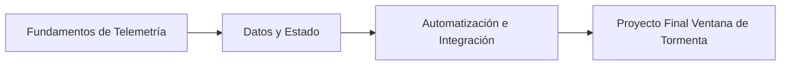

# 🐍 Python: Verdant Relay (MOC)

_Una guía de campo para mantener una red de balizas remotas a lo largo de una reserva costera azotada por tormentas._

**English:** [README.md](./README.md)

---

**Nota:**
Esta página es el mapa central de las notas de Python en este vault de Obsidian. El ejemplo guía sigue **Verdant Relay**, un estudio de operaciones de campo que mantiene balizas remotas — analizando registros, resumiendo lecturas y automatizando informes.

**Consejo:**
Empieza con Arranque de Balizas y avanza por los ciclos de marea hasta el proyecto final Ventana de Tormenta.

---

## 🗺️ Mapa de Contenidos

### 📑 Referencia y Chuletas

* **Chuletas:**
  * [00b - Tarjeta de Campo de Verdant Relay](./00b%20-%20Tarjeta%20de%20Campo%20de%20Verdant%20Relay.md) — Sintaxis, control de flujo, bucles, estructuras de datos, funciones, clases e importaciones.

### 🧠 1. Fundamentos de Telemetría

* **Arranque de Balizas:** [01 - Arranque de Balizas](./01%20-%20Arranque%20de%20Balizas.md) — Salida, variables, tipos de datos y aritmética para lecturas al arrancar.
* **Compuertas de Umbral:** [02 - Compuertas de Umbral](./02%20-%20Compuertas%20de%20Umbral.md) — Errores, condicionales, operadores relacionales y lógicos para alarmas.
* **Ciclos de Marea:** [03 - Ciclos de Marea](./03%20-%20Ciclos%20de%20Marea.md) — Bucles `while`/`for`, `range()`, control de iteración y reintentos.

### 📦 2. Datos y Estado

* **Desviación de Relé:** [04 - Desviación de Relé](./04%20-%20Desviaci%C3%B3n%20de%20Rel%C3%A9.md) — Listas, indexación, rebanado, funciones integradas, métodos e iteración.
* **Pila de Tormenta:** [05 - Pila de Tormenta](./05%20-%20Pila%20de%20Tormenta.md) — Listas anidadas/matrices, diccionarios y conjuntos.

### ⚙️ 3. Automatización e Integración

* **Rutinas de Relé:** [06 - Rutinas de Relé](./06%20-%20Rutinas%20de%20Rel%C3%A9.md) — Funciones, parámetros, valores de retorno, ámbito y lambdas.
* **Clase Baliza:** [07 - Clase Baliza](./07%20-%20Clase%20Baliza.md) — Clases, objetos, `__init__()` y métodos de instancia.
* **Módulos de Relé:** [08 - Módulos de Relé](./08%20-%20M%C3%B3dulos%20de%20Rel%C3%A9.md) — Importaciones, biblioteca estándar y módulos personalizados.
* **Ventana de Tormenta:** [09 - Ventana de Tormenta](./09%20-%20Ventana%20de%20Tormenta.md) — Proyecto final: consola de telemetría integrando todo lo aprendido.

