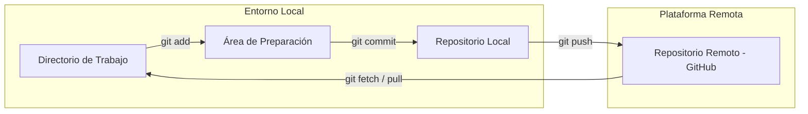

# 🚀 Git & GitHub: Control de Versiones y Colaboración (MOC)

**English:** [README.md](./README.md)

 
   
   
   
  
  

**Nota:**
Este módulo sigue el camino de los **Wayfarer**: dos cartógrafos de expedición, Finch y Mora, que cartografían el Paso de Greyharbor. Sus notas, mapas y manifiestos de suministros viven en un único repositorio. Las lecciones recorren su viaje desde una carpeta solitaria hasta Pull Requests revisados, enseñando comandos reales de Git con salidas plausibles y coherentes entre sí.

---

## 📚 Módulos Principales

1. **[01 - Alijo del Caminante](./01%20-%20Alijo%20del%20Caminante.md)** — ¿Por qué usar control de versiones?, verificación del entorno, `git init`, `git remote add origin`, configuración de la rama por defecto a `main`.
2. **[02 - Marcas del Sendero](./02%20-%20Marcas%20del%20Sendero.md)** — Directorio de trabajo, área de preparación, `git add`, commits con `git commit`, `git status`, primer push con `git push -u origin main`.
3. **[03 - Bifurcaciones del Camino](./03%20-%20Bifurcaciones%20del%20Camino.md)** — Clonado, permisos, fork, ramas con `git branch`/`git switch`/`git checkout -b`, sincronización con `git pull`.
4. **[04 - Revisiones en la Hoguera](./04%20-%20Revisiones%20en%20la%20Hoguera.md)** — Fusión de ramas, resolución de conflictos, flujo de Pull Request, lista de revisión y contribuciones vía fork a proyectos externos.

## 🗺️ Arquitectura y Visión General del Flujo

> [!TIP]
> El alijo es el diario de la expedición. Las ramas son senderos secundarios para explorar. La hoguera es donde se revisan y fusionan esos senderos con la ruta principal.

---
