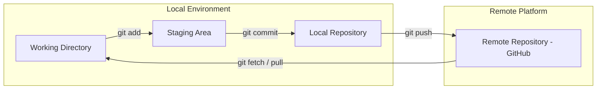

# 🚀 Git & GitHub: Version Control & Collaboration (MOC)

**Español:** [README-ES.md](./README-ES.md)

 
   
   
   
  
  

**Note:**
This module follows the trail of **Wayfarer** — two expedition cartographers, Finch and Mora, charting Greyharbor Pass. Their notes, maps, and supply manifests live in one repository. The lessons trace their journey from a lone folder to reviewed Pull Requests, teaching real Git commands with plausible, internally consistent outputs.

---

## 📚 Core Modules

1. **[01 - Wayfarer Cache](./01%20-%20Wayfarer%20Cache.md)** — Why version control, environment check, `git init`, `git remote add origin`, setting the default branch to `main`.
2. **[02 - Trail Markers](./02%20-%20Trail%20Markers.md)** — Working directory, staging area, `git add`, commits with `git commit`, `git status`, first push with `git push -u origin main`.
3. **[03 - Forks in the Trail](./03%20-%20Forks%20in%20the%20Trail.md)** — Cloning, permissions, forking, branching with `git branch`/`git switch`/`git checkout -b`, syncing with `git pull`.
4. **[04 - Campfire Reviews](./04%20-%20Campfire%20Reviews.md)** — Merging branches, resolving merge conflicts, Pull Request workflow, review checklist, and fork-based open-source contributions.

## 🗺️ Architecture & Workflow Overview

> [!TIP]
> Think of the cache as the expedition log. Branches are side trails for scouting. The campfire is where side trails are reviewed and merged into the main route.

---
